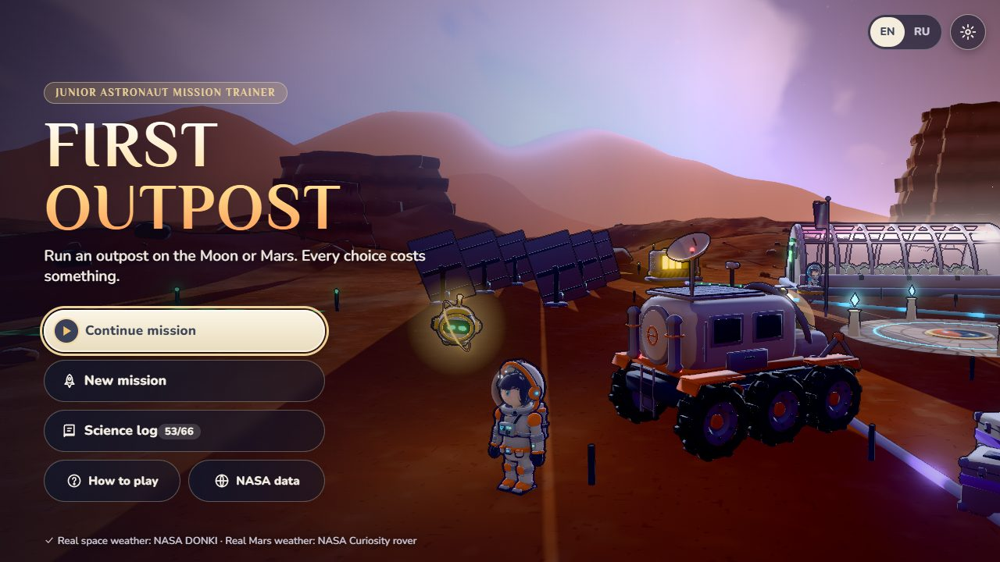
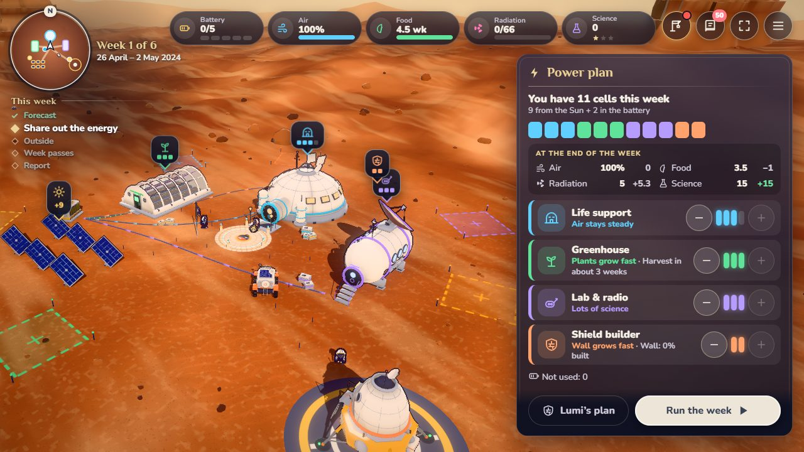
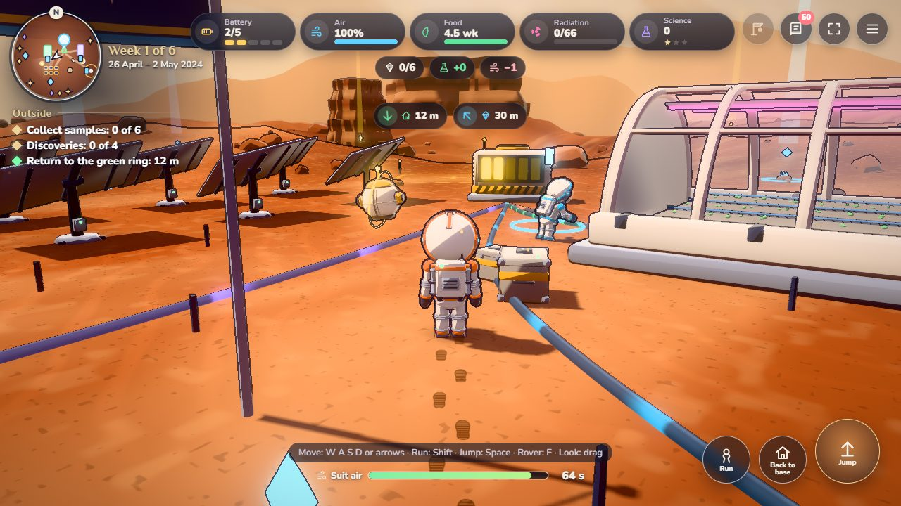
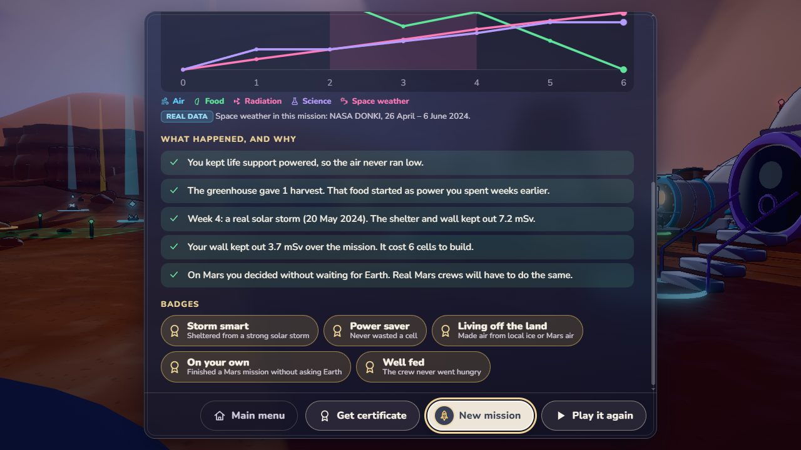

# First Outpost — Junior Astronaut Mission Trainer

**NASA Space Apps Challenge 2026 · Challenge: _Build a Junior Astronaut Mission Trainer_**

### ▶ Play now: <https://first-outpost.vercel.app>

Straight into the real solar storm of May 2024: [on Mars](https://first-outpost.vercel.app/?play=may2024&world=mars) · [on the Moon](https://first-outpost.vercel.app/?play=may2024&world=moon)

In the browser, on a phone, a tablet or a computer. No install, no account, no ads, no tracking. English and Russian.

A free game for ages 7–12. You command a small outpost on **Mars** or at the **Moon's south pole** for 6 or 10 weeks.

- **The Sun in the game is the real Sun.** Every mission replays real dates from NASA's space-weather records (DONKI, 2010–2026). The solar storm of May 2024 arrives in the game on the day it arrived in real life, Mars forecasts show the temperatures Curiosity measured on those dates, and the radio delay to Earth comes from where the planets really were.
- **Every week is a trade-off.** A few energy cells and four systems that want them: life support, the greenhouse, the lab and the radiation shield. There are never enough. The game shows what each choice did, and the final review says which choice caused what.
- **Every task is explained: what to do and why.** The opening film lands the crew, then Lumi flies over the outpost and shows each task of a week (forecast, power plan, air, food, lab, shield, walk, events, night). The forecast, the event card, the power plan (and each of its four systems), the walk briefing and the weekly report have a **Why?** button that replays the task's short film and ends on a card: what to do, why it matters, and a true fact with its source. Big moments get their own film: a solar storm, a Mars dust storm, an eclipse seen from the Moon, the week the Sun blocks the radio to Mars, the first harvest, the first new building, the flight home.
- **Play alone or with friends.** Crew mode is optional: up to four friends fly the very same mission (the same real Sun, the same cards), see each other's astronauts walk around the outpost (with a preset name tag), send preset stickers, wait for each other at the weekly report and compare their crews at the end. No chat, no typed names, no account.
- **Made for 7–12.** Short sentences, science words that explain themselves on tap, recorded voices for the films and Lumi, read-aloud, three text sizes, colour-blind patterns, phone or computer. Lumi, the helper robot, speaks from rules and lines written for the game, not from an AI chatbot: it only says what the team wrote and checked. Its voice is synthetic speech reading those same lines.

**For teachers:** [learning goals, a 40-minute lesson and questions for the class](docs/TEACHERS.md).

<details>
<summary>The outpost grows with you: everything it can do</summary>

The outpost grows with you: dig regolith and metal on walks, build a workshop, an oxygen plant, a solar array, a garden dome, an observatory and a storm bunker, print tools, and walk into every building, and the lander, in 3D, where small games help the crew. A creative mode lets children build anything anywhere.

</details>



| Plan the week | Walk outside, make discoveries | See what your choices did |
| --- | --- | --- |
|  |  |  |

## How the challenge is answered

| The challenge asks for | What First Outpost does |
| --- | --- |
| Kids 7–12 manage a lunar or Martian outpost | Two worlds with different problems. Mars: dust storms, cold, long radio delay, no resupply. Moon: harsh radiation, dark spells, but help is three days away |
| Life support, shielding, power, food, communication delay | One currency (energy cells) and three things to keep alive (air, food, radiation budget), plus science as the goal. Radio delay decides whether Earth's advice arrives in time |
| "A choice that saves power today might cost oxygen tomorrow" | Every card and every power level has a cost. A unit test fails if any card option becomes a free lunch |
| See how choices play out over a mission | A weekly report explains each change. The final review draws the whole mission and links results to the choices that caused them |
| Real NASA data rather than invented numbers | Space weather: NASA DONKI, 2010–2026, replayed by date. Mars weather: Curiosity REMS. Radiation: Curiosity RAD. Distances and radio delay: NASA JPL planet positions. See [docs/NASA_DATA.md](docs/NASA_DATA.md) |
| Attribute data inside the tool | Real-data badges on the forecast, links from storm cards to the DONKI record (or to NASA's report for the storms Curiosity measured), a "NASA data" page, and source links on all 66 Science log cards |
| Do not present saved data as live | The game states where its Sun data came from and when: built-in archive, daily refreshed file, or fetched from NASA in this session |
| Plain language, terms explained in context | Short sentences. Science words are tappable and explain themselves. Optional read-aloud for early readers |
| Low barrier: browser, no account | Static site: about 550 kB of code and styles (compressed, three.js included; crew mode's 8 kB library loads only when a room opens) and 65 kB of built-in NASA data, plus the 3D models: 2.5 MB on phones (5.4 MB at full detail) before the game starts, and the new buildings and the furniture inside (2.8 MB, or 5.3 MB) in the background while you play. Each voice line (about 50 kB) downloads the first time it plays. After the first visit it starts without a connection |
| Two or three core resources, not six | Air, food and radiation, paid for with one currency. New ideas arrive one week at a time in the first mission |
| Replayability | Thousands of real start dates, six famous space-weather windows, "the Sun right now", three difficulty levels, random cards, badges, suit colours and ranks that open as missions are finished, eight discoveries to find outside, six buildings and six tools to choose between (a mission cannot afford them all), five room games and a printer game that get harder as the mission goes on, and a Science log to complete |
| Learn from failure without punishment | Failed missions end with an early flight home, a clear reason, and "try again" |

## Try it in two commands

```bash
npm install
npm run dev
```

Open the address the terminal prints (usually <http://localhost:5173>). To make the final static site:

```bash
npm run build
```

The finished site is in `dist/`. It is plain files: put them on any web host.

**A 3-minute tour for judges**

1. **New mission → Mars → Launch.** The default mission flies through May 2024, the strongest solar storm in 20 years. A voiced film opens the first mission on each world: the lander comes down onto its pad, Mission Control and Lumi say why the crew is there, Lumi shows each task of the week from the building that does it, and a card sums up the goal (keep air, food and the radiation dose in check, earn science) and the four steps of every week. It can be skipped (then the power plan, the walk, the event card and the report each show their own short film the first time they come up, unless the tour already showed them) and replayed from the menu (Story). Press **Why?** on any step to see its film again with the card and its real fact.
2. **Week 1.** Read the forecast: the temperatures are Curiosity's real readings for those dates. Share out the energy cells. Watch the buildings react.
3. **Walk outside.** Run and jump in Mars gravity. Far samples are worth more science, but every second outside uses air. Follow a gold star on the map to a discovery: a cracked rock full of yellow sulfur crystals, like the one Curiosity drove over in May 2024.
4. **Grow the outpost.** Press **Outpost** (top right): the lander brought enough regolith and metal for a workshop. Order it, and give the builder robot a cell in the plan. Two weeks later it stands next to the habitat, and its 3D printer makes tools (a bigger air tank, a drill, a scanner…). Printing is a small game: lay each layer of the tool right on the one below, because whatever sticks out is cut off.
5. **Go inside.** Walk into the greenhouse through its door, or pick a room in the Outpost menu. Inside, walk to a glowing ring: fix the air pipes in the living module, care for the plants, read a rock's light with the lab's laser spectrometer (the lines sit at their real wavelengths, from NIST). The lander that brought the crew down can be entered too: its cockpit runs a landing simulator in real Mars or Moon gravity, and its radio desk sends the science data to Earth.
6. **Weeks 3 and 4.** NASA's model shows a fast solar eruption heading for Mars (the card links to its DONKI record), and the next week brings the 20 May storm that Curiosity really measured. Shelter and lose work time, or keep working and take the dose?
7. **Creative mode.** Back at the start, choose **Mode → Creative**: put buildings and decorations wherever you like (a see-through copy shows where; R turns it), and explore every room.
8. **Finish.** The review shows a chart of the whole mission and says, in plain words, which choice caused what.
9. **Play with friends.** On the title screen, **Play with friends → Make a room** gives a 6-letter code; a friend joins with it, everyone presses Ready, and the host starts. In the game, **Friends** shows each friend's week, air, food, radiation and science; your friends' astronauts stand at the outpost (in their suit colours, with a name tag and a dot on the round map) and walk where the friend walks; a sticker pops up over a friend's head; **Next week** waits for friends who are still behind (**Don't wait** skips it); and the review compares the crews. To try it on one computer, open two tabs at `/?crew=local` (they talk inside the browser, no internet needed).

## How it teaches

**One turn is one week.** The order is always the same:

1. **Forecast** — sunlight, weather, what the real Sun did, the radio delay to Earth.
2. **Card** — a problem based on a true NASA story (Apollo 13's air filter, the 2018 Space Station leak, the zinnias Scott Kelly saved). Two or three answers, each with a visible cost. You may ask Mission Control: near the Moon the answer takes under three seconds; on Mars it can take over half an hour and may arrive too late.
3. **Power plan** — give cells to life support, the greenhouse, the lab and the shield-building robot. The screen shows what the week will do before you commit.
4. **Walk outside (optional)** — a third-person walk in real gravity, with a round map and a short task list on screen. Samples give science. Suits use air, and running uses it faster. A crew rover waits by the plaza: get in and drive it for speed. Its cabin has its own air, so suit time runs slower, but its battery is small and samples can only be picked up on foot. During real storm weeks an alert can sound: get back to the airlock in time. Out in the wild ground wait four discoveries on each world, each a real find by a NASA mission (sulfur crystals, an iron meteorite, an old stream bed and the Murray Buttes on Mars; Apollo's orange glass beads, a piece of the Moon's first crust, a fault scarp of the shrinking Moon and fresh craters on the Moon). Each one opens its own Science log card.
5. **Night and report** — what changed, and why.

**The outpost grows.** Walks also bring back **regolith** (loose rock and dust) and **metal**: stand at a heap and the cadet digs; press the use button while the marker is in the gold zone for one more. Metal veins are a hold-and-release game: hold the button to lift a marker, let go to let it sink, and keep it inside a zone that wanders. NASA plans to build with local material in just this way. The builder robot that piles regolith into the radiation wall also puts up new buildings, so every building is a real choice: the robot works on one thing at a time, needs energy cells, and while it builds, the wall waits. Each building keeps helping for the rest of the mission (more air, more power, food, science, softer solar storms), and the workshop's 3D printer makes tools that change the walks (more suit air, faster digging, a longer-lasting rover battery, a scanner, higher jumps, a radiation vest). The printer builds a tool one layer at a time, as real ones do: each layer slides over the one below, and the player lays it down. Whatever sticks out is cut off (a printer cannot print in thin air), so a sloppy print gets thinner and a neat one saves a piece of metal. A print never fails; a layer that misses is simply tried again.

**Inside the buildings.** Every building except the solar array can be entered, in 3D: the living module, the greenhouse, the lab, the lander that brought the crew down, and the new buildings once they stand. The cadet walks around inside, Lumi floats along, and glowing rings mark what can be used: five small games that help the outpost once a week (connect the air pipes, care for the plants, find the elements in a rock's light, land the lander on its pad in real Mars or Moon gravity, and beam science data to Earth in time with the radio), the workshop's printer, and machines that tell a true story (the water recycler: 98% of the Space Station's water comes back). Each game shows its three star goals first, gets harder as the mission goes on, and ends with a true fact; a lost game can be tried again at once. The radio game shows how long the data really takes to reach Earth that week: about 1.3 seconds from the Moon, 3 to 22 minutes from Mars.

Two more cadets work around the outpost. They go indoors at night and whenever the Sun is dangerous, as a real crew would. In a crew mission your friends' astronauts take their place.

The helper robot **Lumi** reads the plan and says the most useful thing about it ("With this plan the air drops by 11"). Lumi's "safe plan" keeps the crew alive but earns little science, so players must learn to adjust it.

## Real data, used in the mechanics

| Data | Source | What it does in the game |
| --- | --- | --- |
| Solar flares, particle storms, geomagnetic storms, model runs of eruptions reaching Mars (2010–2026) | [NASA DONKI](https://ccmc.gsfc.nasa.gov/tools/DONKI/) | Each mission week is one real week. Storm cards, storm strength and storm alerts during walks come from the records for those dates |
| Daily air temperature at Gale Crater (4,717 sols) | [Curiosity REMS](https://science.nasa.gov/mission/msl-curiosity/) | Shown in the Mars forecast whenever Curiosity has readings for those dates (16 Aug 2012 to 25 Aug 2026); otherwise typical values, labelled as typical. Very cold real weeks can trigger the "bitter cold" card |
| Radiation dose on Mars | Curiosity RAD (Hassler et al. 2014; NASA/JPL) | Sets the weekly cosmic-ray dose and the size of storm doses on Mars |
| Planet positions | [NASA JPL approximate positions](https://ssd.jpl.nasa.gov/planets/approx_pos.html) | Real Earth–Mars distance for the mission dates: radio delay and sunlight strength |
| Space biology | [NASA Veggie fact sheet](https://www.nasa.gov/wp-content/uploads/2023/03/veggie-fact-sheet-508.pdf) | One rounded number: at normal greenhouse power a crop takes 4 weeks, close to real Space Station harvests (radishes 27 days, lettuce 33). A Science log card introduces NASA's Open Science Data Repository (OSDR) |

The films' fact cards also use two resources listed for this challenge: hour-by-hour radiation from [NASA OSDR RadLab](https://visualization.osdr.nasa.gov/radlab/gui/data-api/) (on Mars, Curiosity RAD read about 4.7 µGy per hour on quiet days and 304 µGy per hour at the peak of the 20 May 2024 storm, about 64 times more; the Space Station's DOSTEL read about 4.5), and the [Canadian Space Agency](https://www.asc-csa.gc.ca/eng/sciences/food-production/growing-healthy-food-in-space-and-remote-areas.asp) on why crews far from Earth must grow food. Each card names its source.

Full list, links, numbers and what was simplified: **[docs/NASA_DATA.md](docs/NASA_DATA.md)**. The fact sheets used to check every number, with quotes from the sources, are in [docs/sources/](docs/sources/).

## Made for every device and every child

- **Four graphics levels plus Auto.** Auto picks a level from the device, lowers the picture size when frames drop, and steps down a level if that is not enough. Low runs without shadows, glow or outlines, and loads lighter 3D models. High and ultra add soft contact shadows, light shafts through the Mars dust when the Sun is low, a colour grade for each world (warm gold Mars, cool silver Moon), a glow on bright lights, Phobos and Deimos in the Mars sky, meteors, and a film look in cutscenes (soft focus at the edges). Auto picks ultra only on strong graphics chips (large desktop cards, Apple M Pro, Max and Ultra). Details and measurements: [docs/GRAPHICS.md](docs/GRAPHICS.md).
- **An adventure-game look.** Cel-shaded 3D with drawn outlines, a round map in the corner, the week shown as a quest list, a list of what you pick up, a short camera move and a gold banner when you make a discovery, a rover you can drive across the plain, dust devils wandering across the Mars plain, and a helper robot that speaks like a character in a story game.
- **Phone, tablet, laptop, desktop.** Touch stick and big buttons on touch screens; keyboard and mouse elsewhere; a gamepad works on walks outside and in the rooms. Layouts for upright and sideways phones.
- **Reading help.** Recorded voices for every film line and for Lumi's most frequent lines (they can be switched off: Settings → Voices), a read-aloud button on Lumi and on every card, three text sizes, glossary words explained on tap.
- **Colour-blind help.** Meters and chart lines can use patterns as well as colours. Icons accompany every colour.
- **Less motion.** A calm camera with no shake and no automatic turning, a still camera in the films, and no colour fringes in the film look.
- **Privacy and safety.** Progress is stored only on the device. Besides the game's own files, the game talks to two places. NASA, for newer space-weather records: the request holds two dates and sends no referrer (like any web request, NASA's server sees the network address and the browser type). And, only after a player opens crew mode, Supabase Realtime, which passes game numbers and preset ids between friends in a room: no chat, no typed names, an id that changes on every visit, nothing stored ([docs/MULTIPLAYER.md](docs/MULTIPLAYER.md) lists every field and the limits). The Vercel site sends a strict Content Security Policy (scripts only from the site itself, connections only to the site, NASA DONKI and that one Supabase project; a copy on a host that cannot set headers, like GitHub Pages, runs without it). The recorded voices were made in advance from fixed lines and never hold the player's name, and read-aloud of other texts uses only the device's own voices, since texts can hold the child's name.

## How it is built

- **TypeScript, Vite, three.js, Preact.** No game engine, no game server. Crew mode uses Supabase Realtime only to pass messages between friends: no server code and no database tables ([docs/MULTIPLAYER.md](docs/MULTIPLAYER.md)).
- **Everything is made by code.** The 3D models (the cadet, the rover, the lander, every building, the furniture and machines inside them, the layered rock towers on the Mars skyline and the discoveries) are built by our own Blender scripts in `scripts/models`: no asset packs, nothing modelled by hand. Each model gets bevelled edges and soft contact shadows baked into its colours, and is saved in two versions (full detail and a light one for phones). Textures, animation, the cadet's face, the sound effects and the music are made by the game's code at run time. The pictures of buildings and decorations in the menus are renders of those same models (`scripts/thumbs/render.js`); tools and materials are drawn as SVG in `src/ui/ItemArt.tsx`. The only downloaded pictures are the NASA photos in the Science log.
- **The voices are the only audio files.** Lumi, Mission Control and the storyteller are synthetic voices made with ElevenLabs text-to-speech from the game's own lines, in English and Russian (`npm run voice`, see [docs/VOICE.md](docs/VOICE.md)). The MP3 files are made once by a developer and shipped in `public/voice/`; the game never calls ElevenLabs while people play, and no key is in the site. With read-aloud on, a line without a file is read by the device's own voice.
- **The films are data.** `src/game/films.ts` lists every film as beats (camera shot, speaker, text key), so a film is a few lines of data and its texts live with the other translations.
- **The rules are separate from the graphics.** `src/sim` is pure logic with no screen code, so it can be tested and balanced in Node.
- **Tested.** `npm test` runs 18 test files, 283 tests (all pass). What they check:
  - planet geometry against known Mars close approaches and against the season angle in Curiosity's own records;
  - the DONKI reducer, the live NASA data layer (a bad answer never replaces stored storms), and English and Russian texts with the same keys;
  - the mission rules, including a test that fails if any card option becomes a free lunch, the radio-delay rule, and 3,000 random missions in which no number may leave its range;
  - a balance check that plays about 9,600 missions with five robot players. At the standard level (10 weeks, 300 missions per row): a careful player survives 95% on Mars and 98% on the Moon with about 1.5 stars; a greedy or random player almost never survives; hiding in the base (turtle) earns no science stars; and a careful player who also wins a room game every week averages 2.1 stars, with three stars in 16-17% of missions;
  - the outpost (materials, the robot building instead of the wall, tools that need the workshop, one room reward a week, old saves, creative mode), the discoveries, and the rover;
  - the room games (every pipe puzzle has a solution, a careful pilot lands at every level in real gravity, every game can be won with three stars), the printer game, and the spectrometer's line positions;
  - the mission flow driven step by step with a stand-in 3D world, the suit-colour and rank rewards, and sets of tests for bugs that code reviews and a full code audit found, which must stay fixed;
  - the films (every line and card exists in both languages on both worlds, a task film plays once and leaves its step as it was, Lumi's line comes back after a film, the ending film leads to the review, a skipped night);
  - the voice tools (the credit budget, the order of lines, the file cache, that the key is never written anywhere) and the voice player's fallbacks;
  - crew mode on an in-memory network: rooms, seats, the host's start, status and stickers, throttles, malformed, oversized and forged messages, a host who leaves, a lost connection, and that the same seed gives every friend exactly the same mission.
  - live crew avatars: smoothing, stale friends, base slots, position sending (5 a second, only when changed, keepalive), who the next week waits for, positions through a room.

```
src/sim      mission rules, events, real-data reducers, planet geometry (no graphics)
src/world    3D world: renderer, cel shading, sky, terrain, buildings, astronaut, walk outside
src/game     game flow, films, saved progress, data loading, sound, voices
src/net      crew mode: message rules, rooms, Supabase Realtime transport
src/ui       screens and panels
src/i18n     English and Russian texts
src/data     built-in NASA data (generated by scripts/) and Science log cards
scripts      data fetchers: DONKI, Curiosity REMS, NASA photo library
scripts/models  Blender scripts that build the 3D models (output: public/models/*.glb)
scripts/voice   voice generator, run by a developer (output: public/voice/*.mp3 and manifest.json)
tests        unit tests and the balance simulation
docs         data sources, fact sheets, screenshots
```

## Keeping the Sun data fresh

```bash
npm run data        # rebuild the full archive (DONKI since 2010, REMS)
node scripts/fetch-donki.ts --latest   # only the last 90 days
```

`.github/workflows/update-space-weather.yml` is scheduled to run the second command every day and commit the small "latest" file (a manual run on 13 November 2026 fetched the data and committed it; the first scheduled run is still to be seen). Players who are online also get newer records straight from NASA.

## Rebuilding the 3D models

The models in `public/models/` are built by Blender (4.2 or newer) from the Python scripts in `scripts/models/`:

```bash
blender -b --factory-startup --python-exit-code 1 -P scripts/models/build.py
```

Add model names after `--` to build only some of them, for example `-- astronaut rover`. You do not need Blender to play or to build the site: the finished `.glb` files are in the repository.

## Deploy

The site is static and uses relative paths, so it works from any folder on any host.

- **GitHub Pages:** turn on Pages (Settings → Pages → Source: GitHub Actions), then run `.github/workflows/pages.yml` from the Actions tab.
- **Checks:** `.github/workflows/ci.yml` runs the type check, the tests and the build on every push.
- **Vercel / Netlify / any host:** build command `npm run build`, output folder `dist`. The public version runs on Vercel: <https://first-outpost.vercel.app>.

## Use of AI

### How this was made

The team directed the project and made the design decisions; the code, the Blender scripts, the texts and most checks were written by AI agents (Anthropic Claude, in Claude Code) working in the team's folder. The first commit is one large import because the folder was put under version control when the game was already playable; every later commit is a small, described step, and the review rounds (bugs found by separate reviewer agents, each with a test or a reproduction) are visible in the commit messages. The claims checks (212 claims, 83 links) were also done by agents against the linked NASA pages, not by a human reader. No child has played the game yet: that is the next step, and [docs/TEACHERS.md](docs/TEACHERS.md) is written so a teacher can run it in a lesson.

AI tools (Anthropic Claude) wrote the code, the texts, the Blender scripts that build the 3D models, and the code that makes textures and sound. The facts and numbers shown to players were checked against the linked NASA pages by AI agents, not by a human reader, and the finished texts were checked a second time the same way (212 claims, 83 links); the quotes are kept so a person can re-check them. The eight discovery cards were written from their own check of NASA pages. The records, with quotes, are in [docs/sources/](docs/sources/). No AI image or video generator was used: every model is the output of a script in this repository, and textures, sound effects and music are produced by the game's own code at run time. The voices are the one exception: they are synthetic speech made with ElevenLabs text-to-speech from the game's own checked lines, and the game says so in its About panel.

## Credits and notes

- Space weather: NASA DONKI, Community Coordinated Modeling Center and the Moon to Mars Space Weather Analysis Office.
- Mars weather: REMS, NASA/JPL-Caltech and Centro de Astrobiología (CSIC-INTA).
- Lunar surface dose: Chang'E-4 Lunar Lander Neutrons and Dosimetry experiment (Zhang et al. 2020, _Science Advances_).
- Radiation hour by hour: NASA Open Science Data Repository (OSDR) RadLab, Curiosity RAD and ISS DOSTEL.
- Food in space: Canadian Space Agency.
- Photos in the Science log: NASA Image and Video Library; each card shows its credit line and links to the NASA page.
- Voices: made with [ElevenLabs](https://elevenlabs.io) (free plan, used non-commercially). The voices are synthetic.
- Crew mode: Supabase Realtime.
- Fonts: Nunito, Unbounded and Philosopher (SIL Open Font License).
- NASA does not endorse this game. It is a training game, not an official NASA product.

Code: MIT License (see [LICENSE](LICENSE)).
